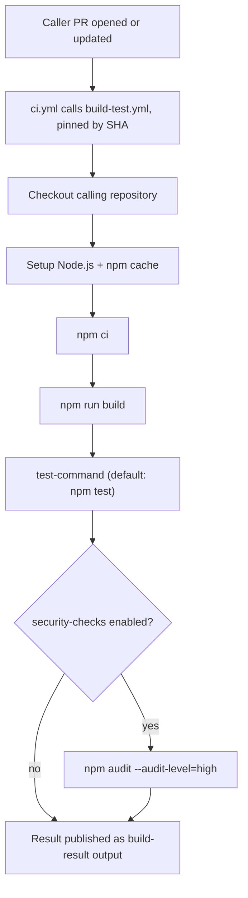
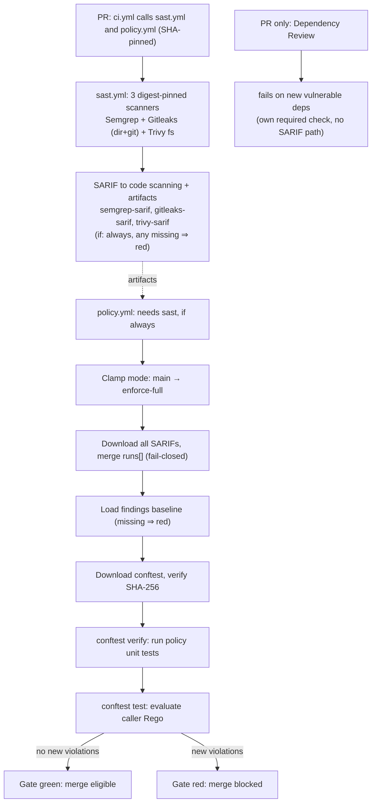

# Reusable Build & Test

A set of reusable GitHub Actions workflows that gives any repository in this org the same
Node.js build, test, and security pipeline (install/build/test/audit, a static analysis
scan, and a fail-closed policy gate) without redefining it in every repo.

## Why this repository exists

CI configuration tends to get copied between repositories, then drifts: different Node
versions, unpinned actions, forgotten audit steps. The goal here is one maintained pipeline.
A caller repository keeps a few jobs in its own workflow file and delegates everything
else to this repository. Runner images, Node defaults, action updates, scanner tooling,
and gate policy mechanics are decided once here and rolled out to callers by moving a
release tag's commit SHA.

## Workflows at a glance

| Workflow | File | What it provides |
|---|---|---|
| Build & Test | `build-test.yml` | `npm ci`, build, test, `npm audit` |
| SAST | `sast.yml` | digest-pinned Semgrep + Gitleaks + Trivy scans and a PR-time Dependency Review; SARIF to code scanning + artifacts |
| Policy Gate | `policy.yml` | fail-closed OPA/conftest gate over all scan results, checked against a findings baseline |

The security pair (`sast.yml` + `policy.yml`) is designed to be called together: the scan
produces SARIF artifacts, the gate consumes them and decides merge eligibility. What the
gate decides (modes, baselines, deny rules) is Rego policy owned by the caller; the
workflow provides the trusted mechanics around it.

## What build-test.yml does

Triggered through `workflow_call`. Runs on `ubuntu-24.04` with `contents: read`
permissions and no access to caller secrets:

1. Check out the calling repository
2. Set up Node.js (`node-version` input, npm cache keyed on the caller's lockfile)
3. `npm ci`
4. `npm run build`
5. Run `test-command`
6. If `security-checks` is true, `npm audit --audit-level=high`



## How the security gate works



**Scan (`sast.yml`)**

- **Semgrep** runs from a digest-pinned container (`semgrep/semgrep:1.179.0@sha256:…`);
  no rule source is fetched from the network — the caller passes a vendored rule bundle
  (`semgrep-config`, default `policy/semgrep-rules`). `--no-rewrite-rule-ids` keeps
  registry rule IDs intact so code-scanning alerts deduplicate across runs.
- **Gitleaks** runs from a digest-pinned container (`ghcr.io/gitleaks/gitleaks:…@sha256:…`)
  in two passes — the worktree (`dir`) and full git history (`git`, `fetch-depth: 0`) —
  whose SARIFs are merged into one artifact. Built-in rules apply unless
  `gitleaks-config` points at a config; a root `.gitleaksignore` suppresses
  documented false positives at the tool level.
- **Trivy** runs from a digest-pinned container (`ghcr.io/aquasecurity/trivy:…@sha256:…`)
  in filesystem mode (`trivy-scanners`, default `vuln,misconfig`): lockfile CVEs and
  IaC/Dockerfile misconfigurations, no build. Misconfiguration checks are frozen inside
  the pinned binary (`--skip-check-update`); the vulnerability DB is downloaded with
  Trivy's built-in signature verification.
- **Dependency Review** (PR events only) fails the job when a PR introduces a
  dependency advisory at or above `dep-review-fail-on` (default `low`). It produces no
  SARIF, so callers list it as its own required status check.
- Every scanner runs report-only at tool level (`--exit-code 0`); blocking is the
  gate's job. Each SARIF uploads to code scanning (distinct `category`) and archives
  as an artifact (1-day retention, `if-no-files-found: error`).

**Gate (`policy.yml`)**

Every step fails closed (anomaly ⇒ red, never green):

1. **Mode clamp**: when the ref is `main` (base or head), the effective mode is forced
   to `enforce-full` regardless of the caller's `mode` input; callers cannot relax the
   gate for merges. An unknown mode is a hard error.
2. **Artifact download**: every name in `sarif-artifacts` (default
   `semgrep-sarif,gitleaks-sarif,trivy-sarif`) must download and contain a `.sarif`
   file — a missing artifact fails the gate.
3. **SARIF merge + validation**: all runs are concatenated into one document; each run
   must have a tool name and `results[]`; `tool.driver.rules` is optional per run
   (severity resolution falls back when absent).
4. **Baseline load**: `baseline-file` (default `policy/baseline.json`) must exist and
   hold well-formed fingerprints — unless explicitly passed as empty to disable.
5. **Trusted toolchain**: conftest is installed to `$RUNNER_TEMP` and checked against
   the embedded `conftest-sha256` before execution.
6. **Policy unit tests first**: `conftest verify` must pass before the gate evaluates.
7. **Evaluation**: `conftest test --parser json --output github` against
   `{mode, sarif, baseline}` input; findings annotate the run (warning or error by mode).

### Gate modes

| Mode | Behavior |
|---|---|
| `warn` | advisory only: findings annotate the run, never block |
| `enforce-critical` | blocks on findings at error level |
| `enforce-full` | blocks on every finding, any level |

Modes are for testing on non-main branches; `main` is always clamped to
`enforce-full`. The caller's Rego decides which findings are suppressed (e.g. a
checked-in baseline of known vendored findings) — there are no path exemptions in
these workflows.

The gate job must be wired with `if: ${{ always() }}` and `needs: [sast]` (as in the
usage example): if the scan fails or its artifacts are missing, the gate still runs
and fails rather than silently passing.

## Usage

```yaml
jobs:
  build-and-test:
    name: Build & Test
    uses: enofei/reusable-build-test/.github/workflows/build-test.yml@de6baabebe8d9663ba701d49ea026d5a07cf1575  # v1.0.0
    with:
      node-version: '24'
      test-command: 'npm run test:ci'
      security-checks: true

  sast:
    name: SAST
    permissions:
      contents: read
      security-events: write
    uses: enofei/reusable-build-test/.github/workflows/sast.yml@de6baabebe8d9663ba701d49ea026d5a07cf1575  # v1.0.0
    with:
      semgrep-config: 'policy/semgrep-rules'

  policy:
    name: Policy
    if: ${{ always() }}
    needs: [sast]
    permissions:
      contents: read
      actions: read
    uses: enofei/reusable-build-test/.github/workflows/policy.yml@de6baabebe8d9663ba701d49ea026d5a07cf1575  # v1.0.0
    with:
      mode: 'enforce-full'
      policy-path: 'policy/'
```

Always pin a full commit SHA with a version comment. Branch and tag refs are mutable and
can change after review; a SHA cannot.

Check names appear as `<caller job name> / <inner job name>`; with the names above:
`Build & Test / Build & Test`, `SAST / Semgrep`, `SAST / Gitleaks`, `SAST / Trivy`,
`SAST / Dependency Review`, `Policy / Gate`. Those exact strings are what a caller
lists in branch protection as required status checks (`SAST / Dependency Review` only
reports on pull requests, so it should be required alongside the rest).

## Inputs

### build-test.yml

| Input | Type | Default | Description |
|---|---|---|---|
| `node-version` | string | `'24'` | Node.js version passed to `actions/setup-node` (current LTS line) |
| `test-command` | string | `'npm test'` | Command run after the build |
| `working-directory` | string | `'.'` | Directory containing the Node project |
| `security-checks` | boolean | `false` | Also run `npm audit --audit-level=high` |

### sast.yml

| Input | Type | Default | Description |
|---|---|---|---|
| `semgrep-config` | string | `'policy/semgrep-rules'` | Vendored rule bundle path (default) or registry ref |
| `paths` | string | `'.'` | Paths to scan (space-separated) |
| `gitleaks-config` | string | `''` | Optional Gitleaks config; empty uses built-in rules (a root `.gitleaksignore` is always honored) |
| `trivy-scanners` | string | `'vuln,misconfig'` | Trivy fs scanners (comma-separated) |
| `dep-review-fail-on` | string | `'low'` | Dependency Review fail-on-severity (`low` \| `moderate` \| `high` \| `critical`) |

### policy.yml

| Input | Type | Default | Description |
|---|---|---|---|
| `mode` | string | `'enforce-critical'` | `warn` \| `enforce-critical` \| `enforce-full`; `main` is clamped to `enforce-full` |
| `policy-path` | string | `'policy/'` | Directory containing the caller's Rego policies and tests |
| `sarif-artifacts` | string | `'semgrep-sarif,gitleaks-sarif,trivy-sarif'` | Comma-separated artifact names; every one is required |
| `baseline-file` | string | `'policy/baseline.json'` | Findings baseline; empty string uses an empty baseline (nothing suppressed) |
| `conftest-version` | string | `'0.71.0'` | conftest release version (must match `conftest-sha256`) |
| `conftest-sha256` | string | embedded | Trusted SHA-256 of the conftest Linux x86_64 tarball |

## Outputs

- `build-test.yml` → `build-result`: the result of the `build-and-test` job
  (`success`, `failure`, and so on).
- `sast.yml` → `semgrep-result`, `gitleaks-result`, `trivy-result`,
  `dep-review-result`: the results of each scanner job.

## What callers must provide

**Build & Test**: inside `working-directory`, a `package.json`, a `package-lock.json`
(the npm cache step fails without it), a `build` script, and the script named by
`test-command`. That is the whole contract.

**SAST + Policy Gate**: additionally

- `policy/semgrep-rules/`: the vendored rule bundle the Semgrep scan reads (no network
  fetch at scan time; see a caller repository for the provenance-file pattern).
- `.gitleaksignore` (optional): one fingerprint per line (`path:rule:line` for the
  worktree pass, `commit:path:rule:line` for the history pass) to suppress documented
  Gitleaks false positives at the tool level.
- `policy/*.rego`: the gate rules and their `*_test.rego` unit tests
  (`conftest verify` runs before evaluation and fails the gate if tests fail).
- `policy/baseline.json`: findings baseline with a `fingerprints[]` array of
  `{sha256, tool, ruleId, path, message}` objects — known findings that are
  suppressed in every mode; anything not in the baseline is evaluated normally.
  Missing or malformed fails the gate.
- Job permissions: the `sast` job needs `security-events: write` (SARIF upload); the
  `policy` job needs `actions: read` (artifact download).
- The gate job wired as `if: ${{ always() }}` with `needs: [sast]`.

Baselines, severity thresholds, and any finding suppression belong in the caller's
Rego and baseline file, not in these workflows — these workflows enforce uniformly
and carry no path exemptions.

## Operating the baseline (caller runbook)

The gate is intentionally fail-closed, so three kinds of drift will turn it red
after changes that look unrelated. All three are working as designed.

**1. Rebuild the baseline from CI artifacts, not local rescans.** When the gate
fails on findings your local simulation missed, download the exact inputs the
gate consumed and regenerate from those:

```bash
gh run download <run-id> --pattern '*-sarif'   # semgrep-sarif, gitleaks-sarif, trivy-sarif
```

Local parity traps: Gitleaks must be invoked with the same subcommands CI uses
(`gitleaks dir .` / `gitleaks git .`, not `detect`), and Trivy's vulnerability
DB is fetched fresh on every run — a local cache can be days behind CI and
miss CVEs that CI will flag.

**2. Vulnerability-DB drift.** Trivy downloads the latest DB at scan time
(signature-verified). New CVEs against vendored/lockfile dependencies appear
as new findings overnight; under `enforce-full` they block until fingerprinted
into the baseline (or the dependency is fixed). This is the fail-closed
contract, not a bug.

**3. Vendored rule-bundle reflows shift line numbers.** `.gitleaksignore`
fingerprints are line-sensitive:

- worktree pass: `path:rule:line` — refresh when the vendored file is
  re-fetched and content shifts (the gate tells you the new line in its
  deny message);
- history pass: `commit:path:rule:line` — the line is as-it-was in that
  commit's blob, so old entries stay valid; new commits touching the file
  may add new worktree fingerprints only.

Gitleaks dedupes history findings to the earliest commit that contains them,
so one history entry per false positive usually suffices.

Baseline hygiene: fingerprint only vendored/test content. A first-party
finding in the baseline is a reviewable, signed diff — treat every added
fingerprint as a finding that stops blocking.

## Resolving a release tag to a pin

```bash
./scripts/resolve-action-sha.sh enofei/reusable-build-test v1.0.0
# prints: <commit-sha>  # v1.0.0
```

The script dereferences annotated tags, so the output is always a commit SHA.

## Branch and signing policy

`main` accepts only commits with verified signatures. Branch protection enforces this with
administrators included, so GitHub itself refuses unsigned or unverified pushes (`GH006`).
Routine work happens on `dev`; a signed commit from `dev` can be pushed to `main` directly,
or merged through a pull request (GitHub signs its merge commits). Commits made on a machine
with the signing configuration in place are signed automatically. Caller repositories layer
their own required status checks on top (see `enofei/caller-repo` for the enforced setup
and its break-glass runbook).

## Releasing

1. Merge changes into `main`.
2. Tag it: `git tag -a vX.Y.Z -m "..." && git push origin vX.Y.Z`.
3. Update caller pins to the tag's commit SHA using the script above.

Dependabot runs weekly (Mondays) and opens grouped PRs that bump the pinned action SHAs
with a `ci` commit prefix. The repo publishes a single rolling release tag, so caller pins
only move when that tag is re-cut.

## Local testing

There is no local runner for a `workflow_call` job. Changes are tested by opening a pull
request in a caller repository (see `enofei/caller-repo`), which exercises the workflows
against real code before a release tag is cut. Caller-side policy changes can be tested
locally with `conftest verify --policy policy/` and `conftest test --policy policy/ --parser json <input>`.
When a CI gate run disagrees with your local simulation, replay it against the run's
downloaded SARIF artifacts (`gh run download --pattern '*-sarif'`) — see
"Operating the baseline" above.
